# Ethiopian AI Keyboard — System Design

**Document status:** Implementation-readiness baseline
**Version:** 1.4 (merchant accounts, billing integrity and starter entitlements)
**Date:** 16 November 2026  
**Working product name:** Ethiopian AI Keyboard (brand name to be selected)

---

## 1. Executive summary

The product is an AI-powered multilingual communication keyboard, launched for Ethiopians in Ethiopia and the diaspora, with a planned expansion to wider African languages and markets. The keyboard is the primary interface; companion applications provide account management, advanced voice experiences, language settings, translation history (only when explicitly enabled), subscription management and other extended workflows.

The product's central promise is:

> **Write naturally in your language. Communicate with the world.**

Users can type in a language they know, choose or save a destination language, translate their draft, review the result and insert it into the active application's text field. The host application remains responsible for sending the message. The keyboard must never send messages automatically.

The product combines:

- Native Android and iOS keyboards.
- Offline multilingual typing, transliteration, dictionaries, suggestions and basic autocorrection.
- Translation from the user's writing language into a saved or temporarily selected destination language.
- AI grammar correction, rewriting, tone adjustment, smart replies and summarisation.
- Voice-to-text and speech translation, available inside the Android keyboard where platform and distribution rules permit, and in the companion applications on both platforms.
- A Spring Boot backend for identity, preferences, AI orchestration, language-resource distribution, usage limits, billing integration and administration.
- A web administration console for managing language resources, providers, prompts, plans, feature flags and operational metrics.

The architecture is deliberately **offline-first for ordinary typing** and **server-assisted for optional AI functions**. A user's ordinary keystrokes must not be streamed to the backend.

## 2. Product goals and non-goals

### 2.1 Goals

1. Make high-quality typing available for the initial language set: Amharic, Tigrinya, Afaan Oromoo and English. Treat this as the initial product recommendation; confirm the launch set with user research and native speakers.
2. Support the appropriate writing systems: Ge'ez/Ethiopic for Amharic and Tigrinya, and Latin-based Qubee for Afaan Oromoo and English. For Amharic and Tigrinya, users must be able to type Latin phonetic sequences on a familiar QWERTY/English keyboard and see them automatically transliterated into Ge'ez characters.
3. Let users configure typing languages, per-language input modes, and a default translation destination in the companion app or keyboard settings.
4. Provide quick keyboard controls for changing the destination language and switching between direct-script, phonetic transliteration and Latin passthrough modes without navigating away from the current app.
5. Translate a draft and place the translated text into the current text field only after user review/confirmation.
6. Offer grammar correction, rewriting and tone controls for supported languages.
7. Offer voice transcription and optional transcription-plus-translation workflows, subject to platform restrictions.
8. Support the Ethiopian market first and make languages, resource packs, pricing and feature availability configurable for future African-market expansion.
9. Provide subscription and usage controls without charging for basic typing.
10. Protect typed content and make all transmission of text/audio explicit and user initiated.

### 2.2 Non-goals for the first release

- Replacing WhatsApp, Telegram, Messenger, email or other host applications.
- Automatically reading all messages in other applications or monitoring all clipboard content.
- Automatically pressing the Send button or sending a message on the user's behalf.
- Building a general-purpose social network or chat platform.
- Building a complete machine-translation or speech-recognition model from scratch as a prerequisite for launch.
- Supporting every Ethiopian language on day one.
- Storing raw keystrokes, raw message drafts or voice recordings for analytics.
- Microservices, Kubernetes or a distributed event platform before product scale justifies them.

## 3. Users and primary scenarios

### 3.1 Initial user groups

- People in Ethiopia who communicate across Amharic, Tigrinya, Afaan Oromoo and English.
- Ethiopian diaspora users who write in an Ethiopian language but communicate with people in English or another language.
- Users who understand a language when speaking but prefer AI help with spelling, grammar or formal writing.
- Users who need speech-to-text or translation to communicate more comfortably.

### 3.2 Core user journeys

#### Journey A — Type in Amharic and prepare an English message

1. User opens any application with a text field and selects the keyboard.
2. User types an Amharic draft.
3. The keyboard uses local language resources for typing assistance.
4. User taps the Translate action.
5. The keyboard uses the saved destination language (English), or the user chooses another language from the quick switcher.
6. The keyboard sends only the selected draft and required language/options to the backend over TLS.
7. The backend checks entitlement/usage, routes the request to a translation provider and returns the result.
8. The keyboard shows the original and translated text for review.
9. User chooses **Insert translation**. The keyboard replaces the current composing text with the translation, or inserts it at the cursor where replacement is not supported.
10. User reviews and taps Send in the host application.

The backend and keyboard do not send the message.

#### Journey A2 — Type Ge'ez using the English/QWERTY keyboard (phonetic transliteration)

1. User enables Amharic or Tigrinya as the active typing language and chooses **Latin QWERTY → Ge'ez (phonetic)** as that language's input mode. This mode can be selected as the saved default, not merely as a one-time conversion action.
2. The keyboard continues to display familiar Latin QWERTY keys. The selected output language/profile determines whether keystrokes are interpreted as Amharic or Tigrinya phonetic input.
3. As the user types a sequence such as `selam`, the on-device transliteration composer updates the active composing region with the best Ge'ez candidate, for example `ሰላም`. The exact mapping and candidate ranking must come from the validated language profile, not a hard-coded universal transliteration table.
4. The candidate strip displays alternatives when a Latin sequence is ambiguous. The user can tap an alternative before committing the word.
5. Space or punctuation commits the selected candidate. Backspace edits the uncommitted Latin sequence and recomputes candidates. Cursor edits and deletion of committed text must remain Unicode-safe.
6. A visible **ABC** / **Ge'ez** mode control lets the user temporarily type ordinary English/Latin text without transliteration, then return to phonetic mode. A user can also select the direct Ge'ez/Fidel layout.
7. Unknown or protected tokens (names, URLs, emails, numbers and technical terms) must be preserved as Latin or offered as candidates rather than silently corrupted.
8. All transliteration runs locally and offline. No keystrokes or composing text are sent to the backend. The backend only distributes signed/versioned transliteration resources and synchronises the user's chosen mode/profile.

This is **transliteration/input-method conversion**, not machine translation: the user's phonetic Latin keystrokes are converted into the target language's writing system. Ordinary English mode must remain a true Latin passthrough mode. Selecting Amharic/Tigrinya phonetic mode is an explicit, saved user choice; do not silently convert normal English typing merely because an English QWERTY layout is visible.

#### Journey B — Save and change destination language

1. User chooses a default destination language in the companion app settings.
2. The preference is synced to the backend and cached locally.
3. A language control in the keyboard displays the current destination.
4. User can temporarily select another destination for the current operation, or update the saved default through an explicit settings action.
5. The selected language persists according to the user's choice.

#### Journey C — Voice-to-text and translation

1. User explicitly activates the microphone/voice action.
2. On Android, the keyboard may offer voice capture when the app, OS version, permissions and store policies permit; otherwise it opens the companion-app voice workflow or invokes a supported system speech recognizer.
3. On iOS, the custom keyboard extension must not assume microphone access. Voice capture is provided through the companion app or a supported system-level dictation workflow.
4. The user selects the spoken language or enables language detection where supported.
5. Audio is transcribed by a configured speech provider. If requested, the transcript is translated into the saved destination language.
6. The transcript/translation is shown for review and inserted only after confirmation.
7. Audio is not retained by default. Any explicit audio-save feature requires separate consent, retention rules and deletion controls.

#### Journey D — Improve grammar or tone

1. User selects text in the keyboard's composing area or explicitly asks the keyboard to improve the current draft.
2. User chooses Grammar, Make professional, Make friendly, Shorten or another available action.
3. Only the selected draft is sent to the AI service.
4. The result is shown beside or in place of the original.
5. User accepts, edits or dismisses the suggestion.

#### Journey E — Understand and reply to an incoming message

The user explicitly selects, copies or shares text into the keyboard/companion-app assistant. The product must not assume it can inspect arbitrary text in another app. It translates or explains the supplied text and can generate a reply in the user's preferred language. Platform-specific share-sheet and clipboard workflows must respect OS privacy controls.

## 4. Product scope and feature priorities

### 4.1 P0 — First useful release

- Android native keyboard and companion/settings experience.
- Initial language support: Amharic, Tigrinya, Afaan Oromoo and English, subject to validation of datasets and layouts.
- Direct Ge'ez/Fidel layout and Latin QWERTY phonetic-to-Ge'ez transliteration for both Amharic and Tigrinya. In phonetic mode, Latin keystrokes must automatically update a live Ge'ez composing candidate (for example, `selam` → `ሰላም`), with candidate selection, word-boundary commit and an obvious ABC passthrough switch.
- Qubee/Latin typing for Afaan Oromoo and true English Latin passthrough; do not apply Ge'ez transliteration to Afaan Oromoo or ordinary English mode.
- Language switching, punctuation, number/symbol layouts and emoji access.
- Local dictionaries, basic next-word suggestions and basic autocorrection where reliable language resources exist.
- User-configured destination language and a quick keyboard destination-language switcher.
- Translation draft → review → insert flow.
- AI grammar correction and basic rewriting.
- Backend identity, device registration, language catalogue, preferences, translation/AI APIs, usage accounting and operational logging.
- Basic companion app for onboarding, permissions explanation, language preferences and account controls.

### 4.2 P1 — Early follow-up

- Android voice input integrated in a platform-compliant way.
- iOS keyboard extension and companion app.
- iOS companion-app voice-to-text workflow.
- Tone adjustment: friendly, polite, professional, concise and apologetic.
- Smart reply suggestions based only on text explicitly provided by the user.
- Per-contact destination-language preferences, if users explicitly configure them.
- Translation history only when the user opts in.
- Subscription products and platform purchase validation.
- Language pack updates and remote configuration.

### 4.3 P2 — Differentiation and expansion

- Voice-to-voice translation and companion-app conversation mode.
- Context-aware/culturally sensitive translation, with native-speaker evaluation.
- Mixed-language/code-switching detection and correction.
- Personal writing-style preferences, opt-in and user-controllable.
- Ethiopian names, place names, expressions and protected vocabulary.
- Text explanation, summarisation and professional email/letter drafting.
- Text-to-speech and pronunciation support.
- Additional Ethiopian and African languages based on demand and language-data quality.
- Offline compact models for selected tasks if quality, device size and performance are acceptable.
- Business/enterprise language resources and APIs.

## 5. Platform architecture

### 5.1 Android

**Native stack:** Kotlin, Android SDK, InputMethodService, Jetpack Compose for the companion/settings app where appropriate.

Main components:

- `KeyboardImeService`: lifecycle and InputMethodService integration.
- `KeyboardView`: keyboard UI, suggestion strip, language switcher and AI action toolbar.
- `InputConnectionAdapter`: safe interaction with the host text field; commit/replace composing text only.
- `TypingEngine`: layout handling, language-specific transliteration, tokenisation, suggestions and autocorrection.
- `TransliterationComposer`: an on-device composition state machine that consumes Latin QWERTY keystrokes, produces live Ge'ez candidates, manages ambiguous sequences, commits at word boundaries, supports candidate replacement and safely handles backspace/cursor edits.
- `LanguageResourceManager`: local resource installation/versioning and fallback behaviour.
- `AiActionCoordinator`: explicitly requested translate/grammar/rewrite operations.
- `VoiceInputCoordinator`: microphone/system recognizer integration only where supported, permissioned and policy-compliant; otherwise companion-app fallback.
- `KeyboardPreferences`: fast local cache of typing and destination language preferences.
- `CompanionApp`: onboarding, keyboard enablement instructions, account, preferences, voice, billing and privacy controls.

The Android implementation must not assume every host application exposes the same editor behaviour. Handle password fields, numeric fields, email/URI fields, secure fields, multiline fields and applications that restrict third-party keyboards.

### 5.2 iOS

**Native stack:** Swift, UIKit custom keyboard extension, SwiftUI companion app.

Main components:

- `KeyboardExtension`: `UIInputViewController` implementation and keyboard lifecycle.
- `KeyboardLayoutView`: key layout and compact AI toolbar.
- `DocumentProxyAdapter`: safe interaction with the current text document via `textDocumentProxy`.
- `TypingEngine`: local layout, language-specific transliteration and suggestions.
- `TransliterationComposer`: a native Swift implementation of the same documented composition behaviour and shared test vectors; it must not depend on network calls.
- `LanguageResourceManager`: offline packs and updates.
- `AiActionCoordinator`: user-initiated online actions when network access is permitted.
- `CompanionApp`: onboarding, account, language settings, voice workflows, subscription management and privacy settings.

Important iOS constraints:

- Custom keyboards are unavailable in some system contexts, including secure text-entry fields and certain restricted fields/apps.
- The host app can choose to disallow custom keyboards.
- A custom keyboard must provide useful functionality without Full Access; network-dependent features require the user to enable the applicable access setting.
- A custom keyboard extension must not assume microphone recording access. Provide voice capture in the companion app or through supported system dictation mechanisms.
- The keyboard cannot arbitrarily read all host-app messages, select arbitrary surrounding text or press the host application's Send button.
- The extension must include a way to switch to the system keyboard and must respect Apple's extension and App Store requirements.

### 5.3 Shared capabilities

Do not try to share the native keyboard UI between Android and iOS. Share product behaviour and portable resources instead:

- Versioned API contracts (OpenAPI).
- Language identifiers and resource manifests.
- Dictionary and terminology formats.
- Transliteration test corpora and expected outputs.
- Common feature codes and entitlement names.
- AI task definitions and prompt versions.
- Design tokens and product specifications.
- Cross-platform acceptance tests where possible.

Keep platform-specific interaction and lifecycle code native.

## 6. Backend architecture

### 6.1 Recommended stack

- Java 21.
- Spring Boot 4.x (confirm dependency compatibility at project creation and pin a tested minor release).
- Spring Security for authentication/authorization.
- REST APIs under `/api/v1`.
- PostgreSQL 17 or a supported current PostgreSQL release.
- Flyway for versioned database migrations.
- Redis only when needed for rate limiting, short-lived caches, idempotency or distributed coordination.
- Object storage for temporary audio uploads only when the selected speech provider requires it; default to short-lived objects and automatic deletion.
- Docker for reproducible local and production deployment.
- OpenTelemetry-compatible structured logs, metrics and traces.
- Next.js admin console as a separate frontend.

Start with a **modular monolith**, not microservices. Keep modules separated by package boundaries and service interfaces so that independent deployment can be considered later if justified by scale.

### 6.2 Logical backend modules

| Module | Responsibilities |
|---|---|
| `identity` | Registration, login, social identity linking, access/refresh tokens, logout and account lifecycle |
| `devices` | Device installations, platform/app version, push-token registration and revocation |
| `languages` | Supported languages, scripts, language packs, resource manifests and installation metadata |
| `preferences` | Typing languages, source-language preference, destination language, translation mode and optional per-contact settings |
| `translation` | Source detection, translation provider routing, translation style, result normalisation and quality metadata |
| `writing` | Grammar correction, rewriting, tone transformation, smart replies and summarisation |
| `speech` | Speech-to-text, optional speech translation and text-to-speech orchestration |
| `ai` | Provider/model registry, prompt templates, safety controls, retry/timeout policy and cost tracking |
| `billing` | Provider-neutral products/prices, payment orders/attempts/transactions, webhooks, refunds, local gateways and store purchases |
| `entitlements` | Plan features, included allowances, credit balance and access decisions |
| `usage` | Per-feature usage, quota enforcement and AI cost accounting |
| `configuration` | Versioned application configuration and feature flags |
| `administration` | Admin access, managed language resources and audit trail |
| `observability` | Health checks, metrics, correlation IDs and operational events |

### 6.3 Provider abstraction

Use interfaces so that a provider can be changed without changing mobile API contracts.

Suggested interfaces:

```java
public interface TranslationProvider {
    TranslationResult translate(TranslationCommand command);
}

public interface SpeechToTextProvider {
    TranscriptionResult transcribe(SpeechCommand command);
}

public interface TextIntelligenceProvider {
    TextTransformationResult transform(TextTransformationCommand command);
}

public interface TextToSpeechProvider {
    SpeechSynthesisResult synthesize(SpeechSynthesisCommand command);
}
```

The backend chooses a provider based on the task, source/target language pair, current availability, configured quality policy, price and latency. Do not expose provider API keys to mobile clients. Store provider secrets in a managed secret store or deployment environment, not in source control or plaintext database rows.

For every language/provider pair, maintain an evaluation set with native-speaker review. Do not advertise a language/task as supported merely because a provider accepts its language code.


### 6.4 Provider-neutral billing architecture

**Non-negotiable design rule:** separate the product/entitlement from the payment rail. Premium access and AI credit packs must be fulfilled through one entitlement service regardless of whether payment came from Chapa, ArifPay, Telebirr Direct, a bank-transfer workflow, Google Play, Apple StoreKit or a future provider.

Do not make `user_subscriptions` depend on a `store_platform` enum. Store purchases and Ethiopian local payments are different ways of funding the same internal subscription record.

#### Billing building blocks

1. **Plans and entitlements:** define what the user can do (Free, Premium, Premium Plus, feature codes and allowances). These are independent of price and payment provider.
2. **Billing products:** define what is sold (a subscription term, AI credit pack or add-on).
3. **Market prices:** define country, currency, sales channel, price, term and renewal model. Store money in integer minor units with a currency exponent; never use floating-point for money. Ethiopia must have ETB price rows. The diaspora can have GBP/USD/EUR rows.
4. **Payment providers:** each provider has an adapter and configuration reference. Provider secrets stay in a secret manager/environment, never in mobile apps or plaintext DB columns.
5. **Provider payment methods:** represent methods supported by a provider, country and currency (for example Chapa + Telebirr + ETB). This is the provider-level catalogue; it is not proof that a specific merchant account has access to that method.
6. **Merchant accounts:** represent each approved gateway/store merchant configuration independently by provider, country, currency and environment (`SANDBOX` or `PRODUCTION`). One provider may have multiple merchant accounts, for example one for Ethiopia/ETB and another for the UK/GBP. Store only secret-manager references, never API keys, webhook secrets, wallet PINs or card data.
7. **Account-enabled methods:** map each provider payment method to a specific merchant account. Checkout is allowed only when the provider, account, base method and account-method mapping are all active/available and the adapter is registered. A provider-wide method flag alone is insufficient.
8. **Payment orders:** snapshot the product, price, amount, country, channel and currency that the user agreed to pay.
9. **Payment attempts:** allow a user to retry an unpaid order using another eligible method/provider/account without creating a duplicate entitlement.
10. **Payment transaction ledger:** record captures, refunds, reversals, fees and chargebacks as separate transactions.
11. **Webhook inbox:** persist provider events idempotently, verify their signatures where supported, and independently verify payment status with the provider before granting anything.
12. **Mandates:** represent recurring-payment permission as its own provider-approved record, linked to the user's explicit `PAYMENT_MANDATE` consent and the exact merchant account/method. A prior one-time charge is never treated as a mandate.
13. **Subscription allocations/events:** map successful orders to the entitlement period they purchase and keep an audit trail of renewals, upgrades, cancellation, refunds and grants.
14. **Billing market/channel policy:** a country/platform/distribution-channel rule determines which checkout flow may be shown. Missing or unreviewed rules fail closed. Never infer that an external checkout is permitted just because a gateway supports it.

#### Merchant accounts and payment-method binding (v1.4)

A provider catalogue row is not a merchant account. The same provider can have separate legal entities, settlement accounts, credentials, webhook secrets, currencies and environments. `payment_provider_accounts` therefore scopes each account by `provider_id`, country, currency and environment. `payment_provider_account_methods` then records which methods have actually been approved and enabled for that exact account.

The checkout eligibility predicate is deliberately strict:

1. `payment_providers.is_active = TRUE` and `provider_status = 'ACTIVE'`.
2. A registered adapter exists for the provider code; missing adapter implementations fail closed.
3. A matching merchant account exists for the order's country/currency and selected environment, with `is_active = TRUE` and `account_status = 'ACTIVE'`.
4. The base `provider_payment_methods` row is enabled and `availability_status = 'AVAILABLE'`.
5. The account-specific method row is enabled and available for that merchant account.
6. The market/channel purchase policy is approved and permits the requested purchase flow.
7. For recurring charges, both the base method and account-specific method explicitly support auto-renew; a provider-approved mandate and unrevoked user consent are also required.

The account/method choice is resolved by the backend. Mobile clients send a public provider/method code only; they never choose a merchant account ID or receive merchant credentials. Old v1.3 attempts and mandates remain readable after migration, but all new attempts and mandates must include a valid account binding.

#### Billing integrity and price versioning (v1.4)

The v1.4 schema adds composite foreign keys so an order's selected price must belong to its product, currency, country and sales channel and the amount snapshot must equal that price; an attempt must match its order's owner, country and currency; a method must belong to the selected provider and market; and a payment transaction must have the same provider and currency as its attempt. A database trigger rejects new orders that use an inactive/out-of-date price or an order type inconsistent with the product type. Mandates and subscriptions retain the exact merchant-account/method binding used for recurring charges.

Active prices for the same product, market, channel, currency, billing period and renewal model cannot have overlapping validity ranges. This is enforced with a PostgreSQL GiST exclusion constraint using the `btree_gist` extension. The migration performs preflight checks on existing order/price, attempt/method and transaction/attempt snapshots, and stops with an actionable error if historical records are inconsistent. It also stops if existing active prices overlap; correct the affected rows before applying it. Price changes should create a new price version and close the old validity range rather than editing historical order snapshots.

#### Ethiopia payment strategy

Make Ethiopia (`ET`) and ETB first-class from the first migration. The initial local-payment implementation should be:

- **Chapa first:** use its server-side hosted checkout as the simplest initial flow; add direct wallet charge only when needed and approved for the merchant account. Chapa API v2 supports hosted checkout, direct/inline wallet charges, payment-method discovery, ETB, and webhooks. Query enabled methods from the provider rather than hard-coding them. See [Chapa API overview](https://docs.chapa.global/docs/v2), [payment methods](https://docs.chapa.global/docs/v2/integrations/payment-methods), and [quick start](https://docs.chapa.global/docs/v2/getting-started).
- **Local methods through Chapa:** the current provider documentation lists local wallet/bank options including Telebirr, CBE Birr, M-Pesa and CBE bank transfer, alongside card and other methods. Exact methods, currency limits and availability must be read from the merchant account's live `GET /v2/payments/methods` response before exposing them.
- **ArifPay second adapter:** its current developer portal documents hosted checkout, C2B direct flows, transaction verification and an advanced recurring-payments area. Treat recurring capability as `APPROVAL_REQUIRED` until ArifPay confirms the specific method, merchant account, country/currency and mandate flow in writing and it passes sandbox/live testing. See [ArifPay developer documentation](https://developer.arifpay.net/docs/api/overview).
- **Telebirr Direct as an optional adapter:** Ethio telecom's developer portal documents a subscription-payment/mandate flow. Its published instructions require a merchant to apply for a mandate template; the customer signs the mandate in the Telebirr app; the merchant implements the scheduled deductions. Do not assume this is automatically enabled for every merchant or use it before approval. See [Telebirr subscription payment documentation](https://developer.ethiotelecom.et/docs/Schedule%20Payment/Introduction).
- **SantimPay as a future adapter:** keep the provider slot in the registry and assess its current API, merchant onboarding, methods, webhook verification and commercial terms before implementation. The National Bank of Ethiopia lists Chapa, ArifPay and SantimPay as commercialised payment-system operators ([NBE register](https://nbe.gov.et/payment-instrument-issuers-system-operators/)). A licence listing does not itself guarantee a particular product, method or merchant is enabled.
- **Manual bank transfer as a controlled fallback:** create a unique order/reference and allow a submitted bank reference/evidence only as a reconciliation claim. Never grant Premium from a screenshot alone; reconcile against bank statement/provider data or require an authorised finance/admin reviewer. This method can be deferred from the first MVP if reconciliation operations are not ready.

#### Subscription renewal model: do not assume recurring charging

A subscription is an entitlement period in the product, not necessarily an automatically debited payment agreement.

- For the first Ethiopia launch, use **one-time fixed-term purchases with `MANUAL_RENEW`** as the default. For example, an ETB payment grants 30 days or 365 days, then the user explicitly purchases the next term.
- Set `AUTO_RENEW` only when the specific provider + payment method + country/currency has a verified mandate/tokenised recurring capability, the provider has approved the merchant, and the user has explicitly consented to the amount/frequency and cancellation terms. Store the provider's mandate reference and status in `payment_mandates`, link the consent record, and attach the mandate to the subscription and each renewal attempt.
- Chapa's published API v2 material documents hosted checkout and direct/inline charges, but this design does not assume that a normal one-off Chapa wallet charge creates a reusable recurring mandate. Obtain written confirmation before enabling automatic renewal through Chapa.
- Telebirr documents a separate subscription-payment mandate workflow; ArifPay documents a recurring-payments capability. Both still require provider onboarding/capability validation and a tested cancellation/failure process.
- When automatic renewal is unavailable, send renewal reminders and create a new payment order only after the user chooses Renew. Do not silently debit a wallet because the user paid once before.
- A mandate is a separate record with provider reference, method, country/currency, permitted interval/amount, customer consent version and timestamps. Cancelling a subscription's auto-renew must invoke mandate cancellation where supported, record the outcome and never keep scheduling debits after cancellation.
- On renewal failure, apply a configurable grace period (if any), then expire paid entitlements. Never consume credit or extend a period until the payment is verified.

#### Diaspora and international billing

Keep market-specific price books for Ethiopia, the UK, the US, Europe and future African markets. Use ETB for Ethiopia and appropriate currencies for diaspora markets. Chapa may provide some card/PayPal methods depending on merchant configuration. The registry also reserves Stripe and PayPal as optional international adapters, but they must remain disabled until the merchant legal entity, settlement bank account, country, currency and customer market are confirmed as eligible. A separate regional gateway can be added through the same adapter contract. Do not assume a provider can onboard an Ethiopia-registered merchant or settle to every country/currency.

#### App-store and distribution policy gates

The billing engine must support app-store purchases, but must not assume app stores are a universal payment method or that local checkout can be inserted into every app build.

- **Google Play:** Google states that Play-distributed digital features and subscriptions normally require Google Play Billing unless an exception or an applicable country-specific alternative-billing program applies. Alternative-billing programmes are not globally available. Google's merchant-registration table currently lists Ethiopia as developer registration supported but merchant registration unsupported for a merchant profile located in Ethiopia. Google also says its billing requirement does not apply in countries where Google Play Billing is not available. Verify the actual purchase availability for Ethiopian customer accounts and the developer's payments profile in Play Console before choosing the Android checkout UI. References: [Payments policy](https://support.google.com/googleplay/android-developer/answer/9858738), [billing policy FAQ](https://support.google.com/googleplay/android-developer/answer/10281818), [alternative billing locations](https://support.google.com/googleplay/answer/11174377), and [developer/merchant registration locations](https://support.google.com/googleplay/android-developer/answer/9306917).
- **Apple App Store:** Apple generally requires In-App Purchase to unlock digital app features/subscriptions. External-purchase links and alternative payment arrangements are limited to specific storefronts/programmes/entitlements. Apple's multiplatform-services rule can allow access to purchases made on a website or another platform, but says the same items must also be available as in-app purchases within the app. Do not add a Chapa/Telebirr checkout link or purchase call-to-action inside the iOS app until the applicable storefront rule and Apple review position have been confirmed. Keep the billing backend capable of StoreKit verification where it is available. Reference: [App Review Guidelines, section 3.1](https://developer.apple.com/app-store/review/guidelines/).
- **Consumption-only builds:** where a platform/store policy and product design permit it, a build may allow a customer to sign in and consume an entitlement bought elsewhere without any in-app purchase flow. Such a build must not contain a prohibited checkout link, button, pricing prompt or purchase call-to-action. Treat this as a platform-specific release configuration, not as a loophole.
- Persist the customer's market country, actual store storefront (when available), client platform, distribution channel and applicable billing-policy decision. Do not select payment rails solely from IP geolocation.

#### Payment adapter contract

Use an internal interface similar to:

```java
public interface PaymentProvider {
    ProviderCapabilities getCapabilities(PaymentContext context);
    PaymentSession createPayment(PaymentOrder order, PaymentMethod method);
    PaymentVerification verifyPayment(PaymentAttempt attempt);
    RefundResult refund(PaymentTransaction capture, Money amount);
    WebhookEvent parseAndVerifyWebhook(RawWebhook request);
    // Optional capabilities; throw/return unsupported unless confirmed for this method.
    MandateResult createMandate(MandateCommand command);
    ChargeResult chargeMandate(MandateChargeCommand command);
    MandateCancellationResult cancelMandate(Mandate mandate);
}
```

`createMandate`, `chargeMandate` and `cancelMandate` are optional capabilities and must not be emulated with a repeated one-time charge. Provider selection is based on a server-side capability matrix, market price, currency, payment method, distribution policy, provider health and merchant configuration.

## 7. High-level architecture diagram

```mermaid
flowchart TB
    subgraph Clients[Client applications]
      AND[Android Keyboard IME]
      ANDAPP[Android Companion App]
      IOS[iOS Keyboard Extension]
      IOSAPP[iOS Companion App]
      ADMIN[Next.js Admin Console]
    end

    subgraph Local[On-device capabilities]
      ENGINE[Typing and transliteration engine]
      DICT[Local dictionaries and language packs]
      PREF[Local preference cache]
    end

    subgraph Backend[Spring Boot modular monolith]
      API[REST API and Security]
      ID[Identity and Devices]
      LANG[Languages and Preferences]
      AI[AI Orchestrator]
      BILL[Billing and Entitlements]
      USAGE[Usage and Cost Accounting]
      ADMINAPI[Administration and Configuration]
    end

    subgraph Providers[External provider adapters]
      MT[Translation provider]
      LLM[LLM provider]
      STT[Speech-to-text provider]
      TTS[Text-to-speech provider]
    end

    subgraph Payments[Payment provider adapters]
      CHAPA[Chapa: ETB checkout and local methods]
      ARIF[ArifPay]
      TELE[Telebirr Direct / mandate]
      SANTIM[Future: SantimPay]
      MPESA[Future: M-Pesa direct]
      FLUTTERWAVE[Future: Flutterwave]
      PESAPAL[Future: Pesapal]
      PAYSTACK[Future: Paystack]
      INTERSWITCH[Future: Interswitch]
      GP[Google Play Billing]
      APPLE[Apple StoreKit]
      BANK[Manual bank transfer review]
    end

    DB[(PostgreSQL)]
    REDIS[(Optional Redis)]
    STORE[(Object storage / CDN for versioned packs and temporary audio)]

    AND --> ENGINE
    ANDAPP --> ENGINE
    IOS --> ENGINE
    IOSAPP --> ENGINE
    ENGINE <--> DICT
    ENGINE <--> PREF
    AND --> API
    ANDAPP --> API
    IOS --> API
    IOSAPP --> API
    ADMIN --> API
    API --> ID
    API --> LANG
    API --> AI
    API --> BILL
    API --> USAGE
    API --> ADMINAPI
    ID --> DB
    LANG --> DB
    AI --> DB
    BILL --> DB
    USAGE --> DB
    ADMINAPI --> DB
    AI --> MT
    AI --> LLM
    AI --> STT
    AI --> TTS
    BILL --> CHAPA
    BILL --> ARIF
    BILL --> TELE
    BILL --> SANTIM
    BILL --> MPESA
    BILL --> FLUTTERWAVE
    BILL --> PESAPAL
    BILL --> PAYSTACK
    BILL --> INTERSWITCH
    BILL --> GP
    BILL --> APPLE
    BILL --> BANK
    LANG --> STORE
    API -. optional .-> REDIS
```



## 8. Translation and AI workflows

### 8.1 Translation request

1. User explicitly activates Translate.
2. Client obtains the composing draft, current/source language if known, and the saved or temporarily selected destination language.
3. Client displays a clear indication that the selected text will be sent for processing.
4. Backend authenticates the user/device, validates languages and request size, applies rate limits and checks the translation entitlement.
5. Backend selects a translation provider and calls it with a bounded timeout.
6. Backend records operational metadata and usage/cost. It does not persist the original or translated text by default.
7. Backend returns the translation and detected-source metadata.
8. Client renders a review state.
9. User confirms insertion. Client commits the result into the current text field. The host application handles sending.

### 8.2 Grammar and rewriting workflow

Use explicit task codes, for example:

- `GRAMMAR_CORRECTION`
- `SPELLING_CORRECTION`
- `REWRITE_NATURAL`
- `REWRITE_PROFESSIONAL`
- `REWRITE_FRIENDLY`
- `REWRITE_POLITE`
- `SHORTEN_TEXT`
- `EXPAND_TEXT`
- `SMART_REPLY`
- `SUMMARIZE_TEXT`

The request should contain only the text needed for the selected action, the task code, language context and optional style settings. Treat user-provided text as untrusted content, not as system instructions. The model must not be allowed to execute tools or actions based on instructions embedded in the supplied text.

### 8.3 Voice workflow

- Capture audio only after an explicit user action and the required OS permission.
- Prefer streaming or short-lived uploads where supported.
- Use signed, short-expiry object-storage upload URLs if audio must be uploaded as a file.
- Do not retain audio by default; delete temporary objects after processing or within a short configured expiry window.
- Store speech-job metadata and cost/latency, not raw audio or transcript content by default.
- If the user enables saved history, use explicit consent, encryption at application level and a user-accessible deletion process.
- Provide clear fallback when a language or provider is unavailable.

### 8.4 Incoming message understanding

Use user-initiated pathways: text selection where the host app permits, copy/paste, share-sheet handoff or manual paste into the companion app. Never promise that the keyboard can read arbitrary incoming messages from every app.

## 9. API design

All APIs are versioned under `/api/v1`. Use JSON over HTTPS, bearer access tokens, idempotency keys for billable/retryable operations, standard pagination and consistent error bodies. Publish an OpenAPI document and generate/validate clients where appropriate.

### 9.1 Authentication and devices

| Method | Endpoint | Purpose |
|---|---|---|
| `POST` | `/api/v1/auth/register` | Register account |
| `POST` | `/api/v1/auth/login` | Login |
| `POST` | `/api/v1/auth/refresh` | Rotate refresh token |
| `POST` | `/api/v1/auth/logout` | Revoke current session |
| `POST` | `/api/v1/auth/password/forgot` | Start password recovery |
| `POST` | `/api/v1/auth/password/reset` | Complete password recovery |
| `POST` | `/api/v1/devices` | Register/update device installation |
| `DELETE` | `/api/v1/devices/{deviceId}` | Revoke device |

### 9.2 Language catalogue and preferences

| Method | Endpoint | Purpose |
|---|---|---|
| `GET` | `/api/v1/languages` | List supported languages/scripts |
| `GET` | `/api/v1/languages/{languageCode}/transliteration-profiles` | List active transliteration profiles for a target language (for example Amharic or Tigrinya) |
| `GET` | `/api/v1/language-packs` | List available resource packs |
| `GET` | `/api/v1/language-packs/{packId}` | Get pack manifest/download information |
| `POST` | `/api/v1/language-packs/{packId}/installations` | Record pack installation |
| `GET` | `/api/v1/me/preferences` | Get user preferences |
| `PUT` | `/api/v1/me/preferences` | Update destination and translation preferences |
| `GET` | `/api/v1/me/typing-languages` | Get enabled typing languages and each language's saved input mode/profile |
| `PUT` | `/api/v1/me/typing-languages` | Replace enabled typing-language list/order and per-language input-mode preferences |
| `GET` | `/api/v1/me/contact-language-preferences` | List optional user-configured contact preferences |
| `PUT` | `/api/v1/me/contact-language-preferences/{contactRef}` | Set a destination preference for a user-defined contact reference |

The `/me/typing-languages` payload must include each language's `inputMode`, optional `transliterationProfileId`, `conversionTrigger`, `showTransliterationCandidates` and `unknownTokenBehavior`. This synchronises preferences only. Actual keystroke conversion is performed locally from the installed signed language-resource pack; there is no per-keystroke API endpoint.

Example per-language preference:

```json
{
  "languageCode": "am",
  "enabled": true,
  "inputMode": "PHONETIC_LATIN_TO_NATIVE",
  "transliterationProfileCode": "AM_PHONETIC_QWERTY_TO_ETHIOPIC",
  "conversionTrigger": "LIVE_COMPOSING",
  "showTransliterationCandidates": true,
  "unknownTokenBehavior": "PRESERVE_LATIN"
}
```

The service must resolve the profile code to an active, compatible profile for that language before saving it. The mobile app downloads/updates the associated rules resource, verifies its checksum, and caches the selected mode locally. The keyboard never calls this API on a keypress.

### 9.3 AI and translation

| Method | Endpoint | Purpose |
|---|---|---|
| `POST` | `/api/v1/ai/translate` | Translate selected draft text |
| `POST` | `/api/v1/ai/grammar` | Correct spelling/grammar |
| `POST` | `/api/v1/ai/rewrite` | Rewrite with selected tone |
| `POST` | `/api/v1/ai/replies` | Generate suggested replies from explicitly supplied context |
| `POST` | `/api/v1/ai/summarize` | Summarise selected text |
| `GET` | `/api/v1/ai/capabilities` | Get currently available tasks/language pairs |

Example translation request:

```json
{
  "text": "User-provided draft text",
  "sourceLanguage": "am",
  "destinationLanguage": "en",
  "style": "NATURAL",
  "preserveNames": true
}
```

Example response:

```json
{
  "requestId": "4ce0a6bd-d7d0-4f2b-a217-2d37c4d2ec7c",
  "sourceLanguage": "am",
  "destinationLanguage": "en",
  "detectedSourceLanguage": "am",
  "translatedText": "Translated text returned for user review",
  "qualityNotice": null
}
```

### 9.4 Speech

| Method | Endpoint | Purpose |
|---|---|---|
| `POST` | `/api/v1/speech/transcriptions` | Create speech-to-text job |
| `GET` | `/api/v1/speech/transcriptions/{jobId}` | Get job status/result |
| `POST` | `/api/v1/speech/translate` | Transcribe and translate audio |
| `POST` | `/api/v1/speech/synthesis` | Generate speech from text where supported |

For large audio, use a short-lived signed upload flow rather than buffering unbounded audio through the API process. The exact streaming design depends on the selected speech provider.

### 9.5 Billing, subscription and usage

| Method | Endpoint | Purpose |
|---|---|---|
| `GET` | `/api/v1/billing/options?marketCountry=ET&clientPlatform=ANDROID` | Return currently approved payment options for the user's market/platform/channel |
| `GET` | `/api/v1/billing/products` | List sellable products and market prices |
| `POST` | `/api/v1/billing/orders` | Create a server-priced payment order (client never supplies a trusted amount) |
| `GET` | `/api/v1/billing/orders/{orderId}` | Get order status |
| `POST` | `/api/v1/billing/orders/{orderId}/attempts` | Start an attempt with an approved provider/method |
| `POST` | `/api/v1/billing/orders/{orderId}/cancel` | Cancel an unpaid order where supported |
| `POST` | `/api/v1/billing/mandates` | Start provider mandate creation after explicit user consent |
| `DELETE` | `/api/v1/billing/mandates/{mandateId}` | Revoke/cancel an active mandate and stop future debits |
| `POST` | `/api/v1/billing/store/{providerCode}/verify` | Verify Apple/Google store purchase evidence server-side |
| `POST` | `/api/v1/billing/webhooks/{providerCode}` | Receive provider webhook; verify signature and payment status |
| `GET` | `/api/v1/me/subscriptions` | List current and historical subscriptions |
| `POST` | `/api/v1/me/subscriptions/{subscriptionId}/renew` | Create a new one-time order for manual renewal |
| `POST` | `/api/v1/me/subscriptions/{subscriptionId}/cancel-renewal` | Cancel a mandate/store-managed renewal where supported |
| `GET` | `/api/v1/me/usage` | Usage and remaining allowances |
| `GET` | `/api/v1/me/credits` | AI credit balance and expiry summary |
| `GET` | `/api/v1/me/credits/transactions` | AI credit ledger history |

Order creation example (the server looks up the active ETB price; amount is not supplied by the client):

```json
{
  "productCode": "PLAN_PREMIUM",
  "marketCountry": "ET",
  "salesChannel": "ANDROID_DIRECT",
  "renewalPreference": "MANUAL_RENEW"
}
```

The response returns a payment order reference, amount/currency, expiry and permitted methods. The client then starts a payment attempt using one returned method. A payment success screen or callback URL is not proof of payment. The backend must verify provider status and match the expected order reference, amount, currency and merchant account before granting an entitlement.

For local wallet/bank options, the app may open a provider-hosted checkout, invoke a direct method where approved, or present bank-transfer instructions. Keep card/mobile-wallet details and provider credentials out of the keyboard client unless the provider's documented SDK specifically requires a public client token.

### 9.7 OpenAPI contract (v1.4)

The companion file `Ethiopian_AI_Keyboard_OpenAPI_v1_4.yaml` is the implementation contract for the public app API. It defines bearer authentication, request/response schemas, validation constraints, idempotency headers for state-changing AI and billing requests, standard Problem Details errors, payment option filtering and the server-side billing flow. Keep the contract versioned with the backend; update it in the same change as controller/DTO changes. Provider webhooks are the exception to bearer authentication: verify provider-specific signatures and transaction state, and do not trust client callbacks.

API implementation requirements:

- Resolve `billingPriceId`, amount, currency, country, channel and product on the server. The client submits a product code and market/channel context, never a trusted price or amount.
- Resolve the merchant account and account-method mapping server-side. Never expose account IDs or secret references in public payment-option responses.
- Require `Idempotency-Key` on order creation, payment-attempt creation, mandate creation and AI actions. Persist the key and return the original result for safe retries.
- Validate the selected price is active at the order creation timestamp and matches product, country, currency, sales channel and renewal model.
- Return only checkout methods passing all provider, merchant-account, method, adapter and market-policy gates.
- Keep webhook endpoints unauthenticated by end-user bearer tokens but protected by provider signature verification, allowlisted network controls where supported, idempotent event storage and server-side provider verification.
- Never grant subscription/credits from app redirect success or an unverified webhook.

### 9.6 Billing webhook processing and fulfilment

1. Receive the provider event at `/api/v1/billing/webhooks/{providerCode}`.
2. Verify provider signature/authentication where supported; persist the event under a unique `(provider_id, external_event_id)` key.
3. Return the provider-required acknowledgement quickly; process asynchronously if needed.
4. Fetch/verify the transaction through the provider's server API. Do not trust a browser redirect or an unverified webhook body.
5. Check provider transaction state, merchant reference, order reference, amount, currency, method, environment and duplicate/reversal state.
6. In one database transaction, mark the attempt/order, append the payment transaction, create/update the subscription or credit ledger and append audit events. Use row locks/idempotency to make repeated webhook delivery safe.
7. On refund/reversal/chargeback, append a financial event and apply the configured entitlement/credit-reversal policy. Preserve the audit record.

## 10. Data and database design principles

The accompanying v1.4 SQL file defines the initial PostgreSQL schema, including merchant-account-level payment routing and relational billing integrity. Key principles:

- UUID primary keys for application entities.
- UTC `timestamptz` for event times.
- Foreign keys and explicit check constraints.
- Versioned language resources stored as files in object storage/CDN; PostgreSQL stores metadata and checksums rather than huge dictionary blobs.
- No raw key logging or keystroke table.
- No raw AI input/output stored in `ai_requests`.
- Optional saved text is stored separately as application-encrypted ciphertext and only after explicit opt-in.
- No raw voice audio stored by default.
- Payment products, entitlements and payment providers are separate entities.
- ETB and other currencies use integer minor units and country-specific price books.
- Payment orders, payment attempts and financial transactions are distinct records.
- Recurring mandates are separately stored, linked to explicit consent and provider approval, and referenced by subscriptions/renewal attempts.
- Payment webhooks are deduplicated and followed by provider-side verification.
- Usage and credit movements are ledger-style records, not mutable audit-free totals only.
- Subscription entitlements are derived/validated server-side and never granted from a client callback alone.
- Billing market/channel policies fail closed until reviewed; platform policy is not inferred from gateway capability.
- Language and feature catalogues are data-driven for future expansion.

The schema includes identity, devices, languages, resource packs, preferences, AI providers/models/language capabilities/prompts, AI usage records, speech jobs, plans and entitlements, billing products and country/channel price books, payment providers and methods, payment orders/attempts/transactions/refunds/webhooks, recurring mandates and mandate events, market policy gates, subscriptions and renewal allocations, credits, usage counters, consent, optional encrypted history, configuration, admin roles, audit events and account-deletion requests.

## 11. Language engine design

### 11.1 Required Latin QWERTY-to-Ge'ez phonetic transliteration (P0)

This is a core product capability, not an optional later enhancement. The user must be able to keep the familiar English/Latin QWERTY key layout while the keyboard automatically converts the user's Latin phonetic keystrokes into Ge'ez/Ethiopic characters for the selected Amharic or Tigrinya typing language.

**Required user-visible input modes**

| Mode | Keys shown | Output | Intended use |
|---|---|---|---|
| `LATIN_PASSTHROUGH` | Latin QWERTY | Latin characters unchanged | Ordinary English or Latin text; temporary code-switching |
| `PHONETIC_LATIN_TO_NATIVE` | Latin QWERTY | Ge'ez/Ethiopic characters | Type Amharic or Tigrinya phonetically using familiar Latin keys |
| `DIRECT_SCRIPT_LAYOUT` | Ge'ez/Fidel keys | Ge'ez/Ethiopic characters | Users who prefer tapping the actual Fidel characters |

For Afaan Oromoo, use Qubee Latin input and language-specific spelling assistance. Do not convert Afaan Oromoo to Ge'ez by default. Future languages/scripts may add their own input modes through data-driven profiles.

**Required behaviour**

- The user selects Amharic or Tigrinya as the output/typing language, then chooses `PHONETIC_LATIN_TO_NATIVE`. The selection can be saved as the default for that typing language and restored on the next keyboard session.
- The keycaps remain Latin QWERTY. The mode indicator must clearly show the active output language and conversion mode (for example `Amharic · ABC → አ`).
- Transliteration is performed locally on each keystroke. The keyboard updates the current composing region with a provisional Ge'ez candidate while the user types; it must not call the backend for character conversion.
- The candidate strip shows alternatives for ambiguous sequences. Candidate ranking can use the active language profile, local dictionary, frequency data, user dictionary and permitted context. Never assume a single universal Latin-to-Ge'ez mapping works for both Amharic and Tigrinya.
- Space and punctuation commit the current candidate. The exact commit behaviour must be consistent across Android and iOS. A configurable word-boundary or manual mode may be offered, but live composing is the default experience.
- Backspace while composing removes the last Latin input unit and recomputes the composing candidate. Backspace after commit deletes a Unicode grapheme safely, not an arbitrary UTF-16 code unit.
- Tapping a candidate replaces the active composing region with that candidate. Users can correct a committed word through normal host-field editing; the keyboard must not corrupt adjacent text.
- The visible `ABC`/Ge'ez mode control switches temporarily between Latin passthrough and the selected language's phonetic mode. A separate layout control exposes direct Fidel input. The user must not have to open Settings for every switch.
- Preserve URLs, email addresses, numbers, emoji, code snippets, user-protected terms and unknown tokens. If no reliable candidate exists, preserve the original Latin token or offer suggestions; do not silently invent a Ge'ez word.
- When the host editor is a password, email, URI, numeric or other sensitive/specialized field, follow the platform's input-type guidance and use a safe Latin/direct-input mode where appropriate. Never force transliteration into fields where it would break expected input.
- Transliteration is not translation. It changes the writing representation of phonetic input; it must not change meaning or send content to an AI provider.

**Language-specific profiles**

- Maintain separate Amharic and Tigrinya transliteration profiles, mappings, exceptions, dictionaries and test corpora. Similar script does not mean identical romanisation or input conventions.
- Each profile has a version, source script (`Latn`), target script (`Ethi`), input-scheme identifier, rules resource, normalization rules and publication status.
- Keep mappings and lexicons in signed/versioned language-resource artifacts, not in backend request code or a universal hard-coded switch statement.
- A profile may expose multiple candidates where romanisation is ambiguous. The profile must document accepted spellings, common alternatives and how users override the preferred result.
- Native speakers must validate the input scheme, mappings, names, common words, informal spellings and dialect coverage before a profile is marked production-ready.

**Illustrative example**

```text
Active typing language: Amharic
Input mode: PHONETIC_LATIN_TO_NATIVE
Key layout: Latin QWERTY
User types: selam
Live composing candidate: ሰላም
User presses Space: commit ሰላም
```

The example demonstrates the interaction, not a complete transliteration standard. The exact mapping rules must be approved by Amharic language reviewers and covered by test vectors.

**Platform implementation**

- Android: use the IME composing-text APIs (`setComposingText`, candidate updates and `commitText`) carefully. Track the Latin composition buffer separately from the rendered Ge'ez candidate. Respect the current `EditorInfo` input type and host-app quirks.
- iOS: use `UITextDocumentProxy` composing behaviour where available and maintain a local composing buffer. Since the extension has less control over host text, test cursor movement, replacement and deletion on physical devices and multiple host apps. Do not assume the same editing APIs or capabilities as Android.
- The transliteration engine must be deterministic for a given profile/version/input/context and must have shared golden test vectors that both native implementations pass.

### 11.2 Engine responsibilities

The on-device engine should be responsible for:

- Keyboard layouts and script-specific key mapping.
- Ge'ez/Fidel character input and phonetic transliteration options.
- Qubee and English Latin-script input.
- Unicode-safe cursor and composing-text behaviour.
- Tokenisation and word-boundary handling.
- Local dictionary lookup.
- Basic candidate ranking and next-word suggestions.
- User dictionary and protected terms.
- Local language selection and code-switching heuristics.
- Offline fallback when the network is unavailable.

### 11.3 Language-resource format

Define a versioned, platform-neutral manifest with:

- Language code (BCP 47-compatible where appropriate).
- Script code.
- Resource type (layout, dictionary, transliteration rules, frequency list, model, protected terms, etc.).
- For transliteration resources: target language, source/target scripts, profile code/version, normalization form, supported input scheme, candidate-ranking version and compatibility information.
- Semantic version and minimum app version.
- Artifact URL, byte size and SHA-256 checksum.
- Signature key identifier and signed manifest metadata; clients verify both the signature and checksum against a pinned/trusted public key before activating a transliteration profile.
- Compatibility/platform metadata.
- Publication status and release notes.

Download resources through HTTPS/CDN. Verify checksums before installation. Install atomically so a failed download cannot corrupt the currently active pack. Keep the last known-good version for rollback.

### 11.4 Code-switching

Treat mixed-language typing as a first-class capability. Do not assume one language per sentence. The engine should:

- Avoid aggressively autocorrecting a token that appears in another enabled language.
- Preserve names, numbers, URLs, email addresses and technical terms.
- Allow users to add words to a personal dictionary.
- Use local heuristics first and optional server-side language detection only when explicitly requested or necessary for a selected AI operation.
- Expose a clear manual override when detection is uncertain.

### 11.5 Language quality gates

A language should not be marked as production-ready until it has:

- Native-speaker-approved keyboard layouts.
- A documented, versioned transliteration specification for the supported mode. For Amharic and Tigrinya this is mandatory: Latin QWERTY input must convert into Ge'ez, with native-speaker-approved mapping tables and ambiguity rules.
- A version-controlled golden test corpus with source keystrokes, expected composing candidates, expected committed outputs, alternatives and known exceptions. Both Android and iOS must pass the same corpus.
- A spelling/wordlist test corpus with permission to use it.
- A set of common names and protected words.
- Prediction/autocorrection acceptance tests.
- Translation evaluation samples for each marketed pair.
- Speech evaluation samples if voice support is advertised.

## 12. Security, privacy and trust

A keyboard is a sensitive application because it participates in text entry. Privacy must be a core product requirement, not a later enhancement.

### 12.1 Data minimisation

- Never transmit every keystroke to the backend.
- Never record typed content for analytics.
- Only send the specific text a user deliberately submits to Translate, Grammar, Rewrite, Summarise or another AI action.
- Make the data transfer clear before or at the point of the first AI use.
- Do not collect text from password or other secure fields.
- Avoid clipboard monitoring. Process clipboard text only after an explicit user action and where OS policy permits.
- Store translation/AI history only when a separate opt-in setting is enabled.
- Do not retain audio by default.
- Provide clear controls to disable AI/network features while preserving offline typing.

### 12.2 Security controls

- TLS for all network traffic.
- Short-lived access tokens and rotating refresh tokens; store only refresh-token hashes server-side.
- Secure local token storage using platform-provided secure storage.
- Server-side provider credentials in a secret manager/environment secret store.
- Request size limits, rate limits, per-user quotas and provider timeouts.
- Idempotency keys for billable actions and webhook processing.
- Strict input validation and output length limits.
- Admin MFA and least-privilege access.
- Redaction of tokens, audio URLs, prompts and user text from logs.
- Dependency scanning, secret scanning and regular security tests.
- Account deletion and data export workflows.

### 12.3 AI processing privacy

For every AI provider, document:

- What fields are sent.
- Whether the provider retains inputs/outputs.
- Whether data is used for provider model training.
- Data residency/processing region where available.
- Retention and deletion behaviour.
- Subprocessor arrangements.

Choose providers and contractual settings that fit the product's privacy commitments. Do not claim end-to-end encryption for text that must be sent to a server-side AI provider.

### 12.4 Consent records

Separate consent for:

- Required terms/privacy acceptance.
- Optional AI processing disclosures where required.
- Saving translation/AI history.
- Saving audio or voice history (if offered).
- Optional analytics/marketing, where applicable.

Record consent version and timestamp. A user must be able to revoke optional consent.

## 13. Subscription and monetisation design

### 13.1 Commercial model

Keep ordinary typing, core language access and offline dictionaries free. Monetise optional, cost-bearing or advanced services:

- **Free:** core typing, local dictionaries, basic suggestions and a small included allowance of selected AI tasks.
- **Premium:** larger translation and AI writing allowances, enhanced voice features and advanced tools.
- **Premium Plus (optional):** larger usage allowances and premium speech/translation capabilities.
- **Prepaid AI credits:** optional top-ups for users who exceed included allowances. Credit-pack sales are digital purchases and remain subject to the payment policy of the distribution channel; credits are not a way to bypass store billing rules.
- **Business/enterprise:** organisation licences, terminology packs and language-quality tools.
- **Language API licensing:** future B2B revenue.

Basic typing must not depend on a paid plan. All plans and allowances are data-driven; do not hard-code feature access in either keyboard app.

### 13.1.1 Starter feature-entitlement matrix (v1.4 proposal)

The SQL seeds the following configurable entitlement defaults. These are **initial product proposals, not final commercial commitments**; validate them against AI-provider costs, expected usage and ETB/GBP/USD pricing before public launch. Basic offline typing, direct Fidel layout and phonetic transliteration remain available in every plan without a server quota.

| Feature | Free | Premium | Premium Plus |
|---|---:|---:|---:|
| Offline typing / direct script / phonetic transliteration | Unlimited | Unlimited | Unlimited |
| Translation | 10 requests/day | 600 requests/month | 2,000 requests/month |
| Grammar correction | 10 requests/day | 600 requests/month | 2,000 requests/month |
| Natural rewrite | 3 requests/day | 300 requests/month | 1,000 requests/month |
| Professional / friendly / polite rewrite (each) | Not included | 150 requests/month | 600 requests/month |
| Smart replies | Not included | 100 requests/month | 500 requests/month |
| Summarisation | Not included | 100 requests/month | 500 requests/month |
| Voice transcription | Not included | 60 minutes/month | 300 minutes/month |
| Voice translation | Not included | 30 minutes/month | 150 minutes/month |
| Text-to-speech | Not included | 60 minutes/month | 300 minutes/month |

`plan_entitlements` stores access, included units, reset period and unit name. Usage enforcement must be atomic and server-side; a client-side counter is display-only. Use the same feature codes as `ai_language_capabilities.task_code` where applicable. When a quota is exhausted, return a structured `QUOTA_EXCEEDED` response with reset time and available upgrade/credit options. The seed rows are inserted with `ON CONFLICT DO NOTHING` so later admin edits are not overwritten by a re-run. Voice usage must be measured from provider-confirmed audio duration and converted to billable minutes using one documented rounding rule (recommended: round each completed request up to the next whole minute); show the same rule in the product UI and terms.

### 13.2 Ethiopia-first price and payment model

- Maintain a dedicated Ethiopia market price book in **ETB**. Keep ETB prices configured by the business/admin; do not derive the ETB retail price from a live FX conversion at checkout.
- Offer local payment methods through a provider adapter. Start with Chapa hosted checkout and discover enabled methods from the merchant account. Add ArifPay as a second gateway after sandbox and merchant onboarding. Keep Telebirr Direct, SantimPay, M-Pesa, Flutterwave, Pesapal, Paystack and Interswitch as separately configurable adapters. Seed future providers as inactive until merchant onboarding, credentials, supported markets, settlement, methods, webhook verification and sandbox tests are complete.
- Support a manual bank-transfer fallback only if a reconciliation process is operated. A user-uploaded receipt/screenshot is not final proof; reconcile a unique bank reference/amount/date against authoritative bank data or an authorised reviewer.
- Offer diaspora price books (for example GBP, USD and EUR) with suitable web/store methods where the merchant can accept and settle those currencies.
- Localise amount, currency, plan term, payment instructions, refund terms and support contact for each market.

### 13.3 One-time term purchase versus automatic renewal

Treat a subscription as a time-bounded entitlement; do not assume it must be automatically charged every month.

- **Ethiopia MVP default:** sell a fixed 30-day or annual term as a one-time payment with `MANUAL_RENEW`. The user's plan becomes active only after server-side verification; the user explicitly chooses Renew for the next term.
- **Automatic renewal:** use only when the exact provider/method supports a mandate or store-managed subscription, the merchant account is approved, the recurring method is verified, and the user has explicitly consented to the debit schedule and cancellation terms.
- Chapa's current public API v2 reference documents hosted checkout and direct/inline wallet charges. Do not interpret a successful one-time wallet charge as permission to reuse a payment method or charge the user later. Obtain provider confirmation of any reusable mandate/recurring API before enabling it.
- Telebirr's developer portal documents subscription payments using a merchant-applied mandate template, customer signing in the Telebirr app and merchant-implemented scheduled deductions. ArifPay's developer portal lists recurring payments among its advanced features. Both require merchant-specific enablement, method-level confirmation, integration testing and cancellation/failure handling before launch.
- When auto-renew is supported, store the mandate/subscription reference (encrypted or protected as needed), next due time, consent details and cancellation status. Never store wallet PINs or card security codes.
- Renewal scheduler must charge only a valid mandate; a normal payment token/reference is not automatically a mandate. If a renewal fails, apply a documented grace period, notify the customer and eventually expire access without deleting payment history.

### 13.4 Billing-provider adapters

Initial provider registry:

| Adapter | Role | Rollout |
|---|---|---|
| `CHAPA` | Ethiopian hosted checkout and enabled wallet/bank/card methods | First local integration; activate only after merchant setup and verification |
| `ARIFPAY` | Alternative Ethiopian checkout/direct payment and potential recurring flow | Second; confirm method and recurring capability |
| `TELEBIRR_DIRECT` | Direct Telebirr and approved subscription mandate flow | Optional after merchant approval |
| `SANTIMPAY` | Additional local gateway | Future; evaluate API and settlement terms |
| `MPESA` | M-Pesa mobile-money network/direct integration | Future; country/operator-specific configuration and onboarding required |
| `FLUTTERWAVE` | Regional/international payment gateway | Future; activate only in approved merchant markets |
| `PESAPAL` | Regional payment gateway | Future; verify country, currency, settlement and merchant eligibility |
| `PAYSTACK` | Regional payment gateway | Future; verify supported merchant countries and settlement |
| `INTERSWITCH` | Regional payment gateway/payment network | Future; verify product, market and merchant eligibility |
| `MANUAL_BANK_TRANSFER` | Controlled manual reconciliation | Fallback only, if staffed |
| `GOOGLE_PLAY` | Play subscriptions/one-time products | Where Play Billing and developer configuration support the purchase |
| `APPLE_APP_STORE` | StoreKit subscriptions/one-time products | Where the App Store storefront/payment setup supports the purchase |
| `STRIPE` | International card and supported local payment methods | Only where the merchant entity, settlement account and customer market are eligible |
| `PAYPAL` | International wallet/card checkout | Only where merchant onboarding, settlement and customer availability are verified |
| Future provider | Any additional gateway, wallet, bank rail or app store | Add through the provider registry and adapter contract; do not require a new provider-specific schema table |

Provider capability is method-, country-, currency- and merchant-account-specific. The admin console should manage provider status, credentials references, permitted markets, method status, one-time/recurring capabilities, min/max amounts, currencies, webhook health and sandbox/live environments. Only `ACTIVE` verified combinations are returned by the payment-options API.

**Provider activation and extensibility controls**

- `payment_providers.is_active` is the global operator-controlled **Active/Inactive** switch. Every provider is seeded with `is_active = FALSE`; this includes Chapa until the merchant account is configured, reviewed, tested and deliberately enabled. New future providers (M-Pesa, Flutterwave, Pesapal, Paystack and Interswitch) are inserted as inactive catalogue entries and cannot appear in checkout merely because they exist in the database.
- `provider_status` is a separate lifecycle/health field (`CONFIGURATION_REQUIRED`, `UNDER_REVIEW`, `TESTING`, `ACTIVE`, `DEGRADED`, `DISABLED`). It is not a substitute for the Active/Inactive switch. A provider is selectable only when `is_active = TRUE`, `provider_status = 'ACTIVE'`, the relevant payment method is `is_enabled = TRUE` and `availability_status = 'AVAILABLE'`, the merchant/country/currency checks pass, and the relevant billing-market policy is approved.
- `provider_payment_methods.is_enabled` is the narrower per-method, per-country and per-currency switch. An operator can disable M-Pesa for one country without disabling another payment method or the whole provider.
- Provider identity is data-driven: `provider_code` is a stable unique code, provider details are stored in `payment_providers`, and method availability is stored in `provider_payment_methods`. Adding another provider in an existing provider category requires a registry row, an adapter implementation registered by `provider_code`, secret-manager references, market/method configuration and tests—not a new provider-specific database table or schema migration.
- **M-Pesa routing distinction:** the `MPESA` catalogue row represents a future direct M-Pesa network/operator adapter. If M-Pesa is offered through an aggregator such as Chapa, record it as a payment method belonging to the `CHAPA` provider instead. These are different processing routes and must not be confused or presented as the same provider transaction.
- The adapter registry must fail closed if no adapter is registered for a configured provider code. Database rows alone do not create an integration. Never allow an admin toggle to make an unimplemented adapter callable.
- Provider credentials remain in a secret manager. For multi-country providers such as M-Pesa, configure country/operator-specific credentials and endpoints using separate secret references and market configuration; do not assume one M-Pesa integration or merchant account works across all countries.
- The payment-options API must return only currently eligible provider/method combinations. It must not expose providers in `CONFIGURATION_REQUIRED`, `UNDER_REVIEW`, `TESTING` or `DISABLED` states, nor any provider with `is_active = FALSE`.
- Keep the catalogue extensible. New providers can use an existing category (`PAYMENT_GATEWAY`, `WALLET_DIRECT`, `MOBILE_MONEY_NETWORK`, `APP_STORE` or `MANUAL`). Adding a genuinely new provider category requires a controlled migration to the category constraint; do not add provider brands as hard-coded SQL enums or Java enums that require app releases for every new provider.

### 13.5 App-store policy and country routing

App-store purchase requirements are independent of payment-gateway capability and must be reviewed separately.

**Google Play**

- Google's payments policy says Play-distributed digital features and subscriptions generally require Google Play Billing unless a stated exception applies.
- Alternative billing programs are available only in specified markets and require program enrolment; Ethiopia is not listed in Google's current alternative-billing country list.
- Google's merchant-registration table marks Ethiopia as developer registration supported but merchant registration unsupported for a merchant profile located in Ethiopia. This is a developer-account/settlement limitation; it does not, by itself, prove whether an Ethiopian customer with an account from another supported market can complete a Play purchase.
- Google also states that Play Billing's requirement does not apply in a country where Play Billing is unavailable. Verify the exact status for Ethiopian buyer accounts and the developer's payments profile in Play Console before deciding whether the Play-distributed Ethiopian build can show Chapa/ArifPay checkout.
- Where policy requires Play Billing, use Play Billing in the Play build. A different Android distribution channel (direct APK or another store) can use its own approved payment flow, subject to local law and the other distribution channel's rules.
- If using a consumption-only Play build, it must not provide a prohibited in-app purchase pathway, link, button or promotional call-to-action. Do not mix a consumption-only design with a disguised local-gateway checkout.

**Apple App Store**

- Apple App Review Guideline 3.1.1 generally requires In-App Purchase to unlock digital app features and subscriptions.
- External-purchase link entitlements/alternative arrangements are limited to particular storefronts and approved programmes. Do not put a Chapa/Telebirr checkout link, button or instruction in the iOS app unless the applicable storefront entitlement/rule permits it.
- Apple's multiplatform-services rule may allow a user to access features/subscriptions acquired on the web or another platform, but says the same items must also be available as in-app purchases within the app. Keep StoreKit product mapping available where required.
- Apple's published payment-method country list should be checked against the user's actual Apple Account storefront. Do not assume a payment route that works for an Ethiopian bank/wallet will work for an Ethiopian Apple Account.
- If a user cannot transact through the Ethiopian storefront, do not attempt to bypass Apple review rules. Obtain written App Review clarification or choose an approved distribution and purchase path for that market. The companion app is still subject to the same digital-purchase rules; moving the checkout from the keyboard extension into the companion app does not automatically make it exempt.

**Backend enforcement**

- Determine a billing market using account/storefront and user-selected country signals, not IP address alone. Store the evidence/source used for the market decision.
- Evaluate `billing_market_channel_policies` before returning checkout options. Missing, expired, `REVIEW_REQUIRED` or `BLOCKED` policy means no purchase UI for that flow.
- Store product/price mappings for Google Play and Apple independently from Chapa/ArifPay prices.
- All successful providers converge on the same internal subscription and entitlement records, but platform-specific client builds may expose different purchasing options according to policy.

### 13.6 Payment fulfilment, security and reconciliation

- All orders are server-priced and snapshot product, price, country, currency and amount in integer minor units.
- Payment attempts are separate so a failed Telebirr attempt can be retried through CBE Birr or another enabled method without duplicate orders/entitlements.
- Verify payment server-to-server, matching merchant reference/order reference, status, amount, currency, environment and provider transaction reference. A return URL is for UX, not proof of payment.
- Verify webhook authenticity, deduplicate provider event IDs and fetch current transaction state from the provider before fulfilment when the API supports it.
- Use database transactions, row locks and idempotency keys for order settlement, subscription creation/extension, credit purchase and refund processing.
- Maintain append-only financial transaction and AI-credit ledgers. Handle refund, reversal, chargeback and late/duplicate webhook events.
- Separate provider processing fees from the customer price and record settlement/reconciliation differences where the provider makes the information available.
- Keep payment-provider secrets server-side. Never store card PAN, CVV, wallet PINs or raw authentication credentials.
- Retain only necessary provider references and redacted metadata according to legal, accounting and provider retention requirements.

## 14. Reliability, performance and scalability

### 14.1 Keyboard performance targets

Initial engineering targets (provisional acceptance targets; measure on named low-, mid- and high-range reference devices and revise from evidence):

- Local Latin-to-Ge'ez transliteration and candidate rendering: p95 <= 30 ms per keystroke on the agreed mid-range reference devices, with no network dependency.
- Keyboard key handling remains responsive during candidate generation; no synchronous disk/network access on the key-event path.
- Keyboard appears promptly and does not block text entry on common devices.
- Local key input and candidate rendering should not wait for network calls.
- Ordinary typing must continue when backend/provider services are unavailable.
- Dictionary lookups should be local and bounded.
- AI actions should show an explicit progress/error state and support retry without duplicating charges.
- Resource pack updates must be resumable/rollback-safe where supported.

### 14.2 Backend resilience

- Provider timeouts and circuit breakers.
- Limited retries only for idempotent/transient failures.
- Per-provider/per-language health metrics.
- Rate limits by user, device, IP and task type.
- Usage reservation/settlement to prevent concurrent quota overspend.
- Idempotency for AI operations when clients retry.
- Graceful provider fallback only when translation quality and language support are equivalent enough; otherwise return a clear unavailable response.
- Database backups and tested restore procedures.

### 14.3 Scaling path

Start with a single Spring Boot deployment and PostgreSQL. Add Redis for caching/rate limiting when measured need arises. Add separate worker processes for long-running speech jobs if required. Move a module to a separate service only when independent scaling, isolation or team ownership justifies the operational cost.

## 15. Observability and product analytics

Track operational metrics without collecting message content:

- API request counts, latency and error rates by task/provider/language pair.
- Translation success/failure and provider cost.
- Speech job completion time and failure rate.
- Token/credit usage and subscription conversion/renewal.
- Language pack download/install success.
- Keyboard crashes, cold-start time and latency of local suggestions.
- App/OS/platform version and anonymised device diagnostics.

Product analytics should be opt-in or configured according to applicable privacy requirements. Never include typed drafts, transcribed speech, translation outputs, access tokens or clipboard content in event properties.

## 16. Testing strategy

### 16.1 Unit tests

- Amharic and Tigrinya Latin-QWERTY-to-Ge'ez mappings, ambiguous-sequence candidate ordering and Unicode correctness.
- Live composition, candidate replacement, space/punctuation commit, backspace, cursor edits and Latin passthrough switching.
- Tokenisation, candidate ranking and autocorrection.
- Language preference fallback and destination switching.
- Translation request validation and quota decisions.
- Billing event idempotency.
- Subscription entitlement evaluation.
- Prompt-template version selection.
- Audio retention/deletion rules.

### 16.2 Integration tests

- Backend API + PostgreSQL via Testcontainers.
- Authentication/session rotation and revocation.
- Provider adapters using deterministic mocks/fixtures.
- Store webhook signature/idempotency tests.
- Language-pack manifest/checksum/download flows.
- Signed upload expiry and voice-job lifecycle.

### 16.3 Native platform tests

- Android IME lifecycle, rotation, split-screen, different densities and manufacturers.
- iOS keyboard extension lifecycle, compact layouts, host-app restrictions and Full Access disabled/enabled states.
- Password/secure fields and numeric/email/URL input types.
- Cursor movement, selection, composing text, deletion and punctuation.
- Switching keyboards and returning from the companion app.
- Keyboard operation while offline and when AI providers fail.

### 16.4 Language acceptance tests

Recruit native speakers for each supported language. Test:

- Common words and sentences.
- Names and place names.
- Mixed-language sentences.
- Dialectal and informal expressions.
- Formal and polite writing.
- Translation meaning preservation.
- Grammar corrections that must not change intent.
- Speech accuracy in quiet and noisy conditions, where voice is supported.

### 16.5 Release gates

Do not publish a language/feature until its minimum quality threshold is met. Do not publish AI features without privacy disclosures, provider cost controls, usage limits and failure handling. Do not submit iOS until keyboard extension behaviour has been tested on physical devices and reviewed against current Apple requirements.

## 17. Deployment and environments

Environments:

- `local`: Docker Compose PostgreSQL, optional Redis and mock AI providers.
- `development`: internal test backend and test provider credentials.
- `staging`: production-like configuration and app-store sandbox purchase flows.
- `production`: isolated secrets, backups, monitoring and restricted admin access.

Deployment recommendations:

- Dockerise the Spring Boot API.
- Run Flyway migrations as a controlled deployment step.
- Use managed PostgreSQL where practical, or a properly backed-up VPS instance.
- Use object storage/CDN for versioned language packs.
- Keep audio uploads in a separate private bucket with short lifecycle rules.
- Use a secrets manager or encrypted deployment secrets.
- Publish admin console separately and protect it with MFA/role-based access.
- Keep mobile API compatibility for at least the supported app versions; use capability/configuration endpoints for gradual feature rollouts.

## 18. Repository structure

```text
ethiopian-ai-keyboard/
├── backend/
│   ├── src/main/java/.../
│   │   ├── identity/
│   │   ├── devices/
│   │   ├── languages/
│   │   ├── preferences/
│   │   ├── translation/
│   │   ├── writing/
│   │   ├── speech/
│   │   ├── ai/
│   │   ├── billing/
│   │   ├── entitlements/
│   │   ├── usage/
│   │   ├── configuration/
│   │   └── administration/
│   └── src/main/resources/db/migration/
├── android/
│   ├── keyboard/
│   └── companion-app/
├── ios/
│   ├── KeyboardExtension/
│   └── CompanionApp/
├── admin/
├── shared/
│   ├── api-contracts/
│   ├── language-resources/
│   ├── test-corpora/
│   └── design-tokens/
├── docs/
│   ├── SYSTEM_DESIGN.md
│   ├── DATABASE_DESIGN.md
│   └── API_CONTRACTS.md
└── README.md
```

## 19. Implementation roadmap

### Milestone 0 — Product and architecture baseline

- Confirm initial launch languages and writing layouts with native speakers.
- Finalise API contracts and database migration conventions.
- Select initial translation, LLM and speech providers after language-quality evaluation.
- Define privacy disclosures and retention policies.
- Establish CI, test strategy and repository structure.

### Milestone 1 — Backend foundation and Android shell

- Spring Boot modular monolith, PostgreSQL and Flyway.
- Identity, device management, language catalogue and user preferences.
- Android companion app onboarding and keyboard-enable instructions.
- Android IME shell and basic layouts.

### Milestone 2 — Offline typing foundation

- Direct Ge'ez/Fidel layout and the required Latin QWERTY-to-Ge'ez phonetic transliteration mode for Amharic and Tigrinya.
- Live composition, candidate strip, word-boundary commit, backspace and ABC passthrough.
- Qubee/English layouts.
- Local dictionaries, suggestions and basic correction.
- Language switching, destination-language quick control and local preference cache.

### Milestone 3 — Translation and writing AI

- Provider abstraction and language capability matrix.
- Translate, grammar and rewrite APIs.
- Usage accounting, quotas, request metadata and error handling.
- Draft preview, accept/replace and user-controlled insertion.

### Milestone 4 — Voice and companion experiences

- Android voice workflow where permitted.
- Companion-app voice capture on Android and iOS.
- Speech-to-text and optional speech translation.
- Audio deletion, consent and provider lifecycle controls.

### Milestone 5 — iOS keyboard

- Swift keyboard extension and SwiftUI companion app.
- Local typing engine integration and language resources.
- Online AI workflows subject to Full Access and extension restrictions.
- Companion-app voice workflow.

### Milestone 6 — Ethiopia-first billing and production hardening

- Implement provider-neutral billing products, ETB price books, orders, attempts, transaction ledger and entitlement fulfilment.
- Integrate Chapa hosted checkout in test mode; dynamically discover/verify methods and limits for the merchant account.
- Implement signature-checked webhook intake plus server-side transaction verification and reconciliation.
- Add ArifPay adapter behind a feature flag after sandbox and merchant onboarding; evaluate Telebirr mandate support separately.
- Implement manual-renew subscription terms first; add auto-renew only for verified/approved mandate methods.
- Add Google Play and Apple StoreKit adapters for eligible storefronts, with explicit market/channel policy gates.
- Validate Ethiopia and diaspora purchase flows with real test accounts, app-store storefronts and provider sandboxes.
- Privacy/security review, provider cost controls, refunds, chargebacks, admin operations, native-speaker quality review and production monitoring.

## 20. Key architectural decisions and open decisions

### Decisions in this baseline

1. Ethiopia-first launch, followed by wider African language expansion.
2. Native Android implementation using Kotlin/Android IME.
3. Native iOS implementation using Swift/Keyboard Extension.
4. Companion applications on both platforms.
5. Spring Boot modular monolith backend.
6. PostgreSQL as the system-of-record database.
7. User can save a default translation destination and change it from a keyboard control.
8. Basic typing, Ge'ez phonetic transliteration and dictionaries work offline.
9. Amharic and Tigrinya users can type Latin phonetic sequences on a QWERTY layout and see live Ge'ez composing candidates; direct Fidel layout and ordinary Latin passthrough remain available.
10. Amharic and Tigrinya use separate, versioned transliteration profiles; Afaan Oromoo uses Qubee Latin input and is not converted to Ge'ez by default.
11. Transliteration mode is an explicit saved per-language preference with a quick in-keyboard switch to ABC/Latin passthrough.
12. AI/translation/voice are explicit online operations, not background keystroke collection.
13. Translation is inserted for review; the host app's Send action remains under user control.
14. Voice is supported in the keyboard where platform rules permit and in the companion apps.
15. Subscription and entitlement enforcement is server-side.
16. Billing products/entitlements are provider-neutral; local and store purchases converge on the same entitlement service.
17. Ethiopia ETB pricing and local payment rails are first-class; local fixed-term purchases default to manual renewal.
18. Automatic renewal is opt-in and method-specific; it requires a verified provider mandate or store-managed subscription.
19. Country/platform/distribution billing policy is checked server-side and fails closed until reviewed.
20. Each merchant/provider account is scoped by provider, country, currency and environment; account-specific method availability is independently enabled.
21. Composite foreign keys enforce price/product/order/attempt/provider/method/account consistency; active price validity ranges cannot overlap for the same commercial scope.
22. Free, Premium and Premium Plus have starter entitlement rows with server-enforced, configurable usage allowances; seed quotas remain provisional until cost and product validation.

### Decisions to validate before implementation

- Exact launch-language set, dialect coverage and script/layout variants.
- Native-speaker-approved Amharic and Tigrinya Latin-to-Ge'ez transliteration schemes, including mapping conventions, ambiguous candidates, accepted spelling variants and the recommended onboarding default. Both phonetic transliteration and direct Fidel layout are required product capabilities; only the exact language rules/profile remain to be validated.
- Initial translation, LLM and speech providers based on independent language benchmarks.
- Whether user accounts are mandatory for basic offline typing or only for sync/AI/premium features.
- Initial free and premium usage limits and ETB/GBP/USD/EUR price points by market.
- Finalise the provisional v1.4 entitlement quotas after real provider-cost modelling and closed-beta usage measurements.
- Chapa merchant onboarding, activated payment methods, transaction limits, settlement account and refund process.
- Whether ArifPay recurring payments and Telebirr mandate deductions are approved for this merchant account and target methods.
- Google Play Billing availability for Ethiopian buyer accounts versus the developer's merchant profile, verified in Play Console.
- Apple storefront purchase options and the exact App Review-compliant path for Ethiopian users who cannot use a local IAP payment method.
- Whether an Android direct-distribution build and a consumption-only store build are needed for a market-specific release strategy.
- Whether translation history is offered at launch; default should remain off.
- Exact Android microphone/speech workflow permitted by target Android versions and Google Play policy.
- Exact iOS extension capability and App Store review approach for network-backed keyboard features.

---

## Appendix A — API conventions

- Base path: `/api/v1`.
- JSON property naming: camelCase.
- IDs: UUID strings.
- Time: ISO-8601 UTC timestamps.
- Errors: stable machine-readable code, safe user-facing message, optional field errors and correlation ID.
- Authentication: short-lived bearer access token; rotating refresh token stored securely on device.
- Retry: use `Idempotency-Key` for billable AI requests and purchase verification where appropriate.
- Text payloads: strict maximum length by task; reject oversized requests before provider calls.
- Never return provider credentials, internal prompts, billing secrets or raw provider error messages.

## Appendix B — Example error response

```json
{
  "code": "LANGUAGE_PAIR_UNAVAILABLE",
  "message": "Translation is not currently available for this language pair.",
  "correlationId": "d8d14c6e-f6da-4c1b-8be8-6be9b5c4f1f5",
  "details": {
    "sourceLanguage": "xx",
    "destinationLanguage": "yy"
  }
}
```


## Appendix C — Billing integration references (checked 16 November 2026)

These references are implementation inputs, not a substitute for merchant onboarding, legal advice or store review. Re-check them before release because provider APIs, payment methods and store policies can change.

- [Chapa API v2 overview](https://docs.chapa.global/docs/v2) — hosted checkout, direct/inline charges and payment verification.
- [Chapa payment methods](https://docs.chapa.global/docs/v2/integrations/payment-methods) — merchant-enabled methods and method capability discovery.
- [Chapa quick start](https://docs.chapa.global/docs/v2/getting-started) — ETB, server-side hosted checkout, integer-minor-unit amounts and idempotency key usage.
- [Chapa webhooks](https://developer.chapa.co/integrations/webhooks) — asynchronous transaction notifications.
- [ArifPay API documentation](https://developer.arifpay.net/docs/api/overview) — checkout, C2B direct payments, transaction verification and recurring-payments documentation section.
- [Telebirr subscription-payment documentation](https://developer.ethiotelecom.et/docs/Schedule%20Payment/Introduction) — merchant mandate-template application and merchant-operated scheduled deductions.
- [National Bank of Ethiopia payment-system operators](https://nbe.gov.et/payment-instrument-issuers-system-operators/) — operator licence/status register.
- [Google Play payments policy](https://support.google.com/googleplay/android-developer/answer/9858738) and [payments policy FAQ](https://support.google.com/googleplay/android-developer/answer/10281818) — Play Billing requirements and country exceptions.
- [Google Play alternative billing locations](https://support.google.com/googleplay/answer/11174377) — enrolled-market availability.
- [Google Play developer/merchant registration locations](https://support.google.com/googleplay/android-developer/answer/9306917) — country-specific developer and merchant registration support.
- [Apple App Review Guidelines](https://developer.apple.com/app-store/review/guidelines/) — section 3.1 digital purchase rules and exceptions.
- [Apple accepted payment methods](https://support.apple.com/en-gb/111741) — country/storefront payment methods.

## Appendix D — Core product rule

**The keyboard is an input method, not a message sender.** It may prepare, transform and insert text into the active field. The user remains responsible for reviewing and sending content in the host application.


### 13.4.1 Version 1.3 provider catalogue migration

For deployments that already applied schema v1.2, apply `V1_3__payment_provider_catalogue.sql` as a Flyway migration. It adds the global `payment_providers.is_active` switch, extends provider categories to include `MOBILE_MONEY_NETWORK`, and inserts M-Pesa, Flutterwave, Pesapal, Paystack and Interswitch as inactive placeholders. It does not enable any payment method or claim that merchant onboarding is available. For a fresh install, use the v1.3 full schema instead of running the v1.3 upgrade migration on top of it.


### 13.4.2 Version 1.4 billing-hardening migration

For an existing v1.3 database, apply `V1_4__billing_accounts_integrity_entitlements.sql` once through Flyway after v1.3. It creates merchant accounts and account-scoped methods, adds composite integrity bindings, adds active-price overlap prevention, backfills attempt market/currency/environment from their orders, and inserts starter entitlement rows. Existing v1.3 attempts and mandates are retained with null merchant-account bindings for historical compatibility; application services and database insert guards require complete bindings for all new attempts/mandates. The migration requires PostgreSQL 17+ and permission to install `btree_gist`. If it reports overlapping active prices, retire or adjust the conflicting rows and retry.

For a fresh install, use `Ethiopian_AI_Keyboard_Database_Design_v1_4.sql` only; do not run the v1.3 or v1.4 upgrade migrations on top of the fresh schema.
